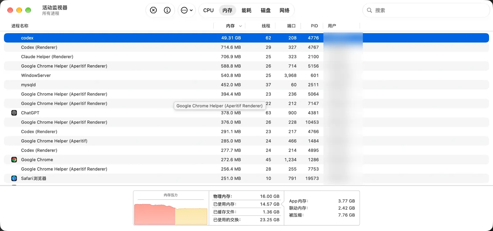

下午电脑越用越卡，打开活动监视器按内存排了一下，第一名是 `codex`：**49.31 GB**。

我这台机器物理内存一共才 16 GB。



底下那栏也很吓人：已使用的交换 23.25 GB，被压缩 7.76 GB。我第一反应是截图甩给克（Claude）：「我去，克，codex吃了我40多G内存？」然后让它帮我查了一下，顺手记一篇。

## 1. 先搞清楚：这个 codex 是谁

活动监视器里跟 Codex 有关的进程有好几个，先看 PID 4776 到底是哪个：

```bash
ps -o pid,ppid,rss,etime,command -p 4776
```

```
  PID  PPID    RSS     ELAPSED COMMAND
 4776  4381 723536 01-00:13:12 /Applications/ChatGPT.app/Contents/Resources/codex-cli/CodexCLI.app/Contents/MacOS/codex -c features.code_mode_host=true app-server ...
```

几个信息：

- 它不是界面。界面是那几个 `Codex (Renderer)`，这个是 ChatGPT.app 里 Codex 在后台跑的 `app-server`。
- 父进程 4381 就是截图里的 ChatGPT。
- `ELAPSED` 是 `01-00:13:12`，也就是已经连续跑了一天零 13 分钟。

## 2. 奇怪：RSS 才七百来 MB？

`ps` 给的 RSS 是 723536 KB，七百来 MB，跟活动监视器的 49 GB 差得离谱。

这俩其实不是一个口径：

- **RSS**：只算现在还待在物理内存里的那部分。
- **活动监视器的「内存」列**：是这个进程的 footprint，被系统压缩掉的、换到硬盘上的也都算进去。

所以 RSS 小，不是说它没占内存，而是它占的大部分已经被系统压缩、或者挤到交换文件里去了。

## 3. 用 footprint 看看都是些什么内存

macOS 自带一个 `footprint` 命令，可以按类别拆开看：

```bash
footprint 4776
```

结果里挑重点：

| 类别 | Dirty | Reclaimable | Regions |
|---|---|---|---|
| Malloc Small | 39 GB | 18 MB | 12088 |
| Malloc Large | 2692 MB | 0 B | 22 |
| Malloc Metadata | 190 MB | 0 B | 387 |
| **合计** | **42 GB** | 18 MB | 16384 |

最后还有两行：

```
phys_footprint: 42 GB
phys_footprint_peak: 51 GB
```

（跑 `footprint` 的时候已经过了一会儿，从截图时的 49 GB 回落到了 42 GB，峰值到过 51 GB。）

怎么看：

- **几乎全是 Malloc Small**：程序自己 `malloc` 出来的小块内存，散在 1.2 万多个区域里。
- **全是 Dirty**：写过数据的页，系统不能直接丢掉，只能压缩或者换出去。
- **Reclaimable 只有 18 MB**：系统想回收也收不回来。
- **不是映射文件、不是缓存、不是代码段**：就是堆上的对象一直攒着没释放。

一个后台进程，堆上的小对象攒了 39 GB 还在涨，基本就是内存泄漏了。也可能是某个缓存没设上限、一直往里塞，不过从外面看，两种情况是一回事。

## 4. 16G 的机器，怎么装下 42G 的？

靠的是 macOS 的两招：

1. **内存压缩**：不常用的页先压一压，对应截图里的「被压缩 7.76 GB」。
2. **交换**：压完还放不下，就写到 SSD 上，对应「已使用的交换 23.25 GB」。

所以机器没崩，但是会越来越卡：每次用到被换出去的内存，都要从硬盘读回来。而且一直在往 SSD 上写，对硬盘也不友好。

## 5. 一个线索：没退出的 computer-use 进程

顺便看了一下它的子进程：

```bash
ps -axo pid,ppid,rss,etime,command | awk '$2==4776'
```

除了一个 `codex-code-mode-host`，还挂着 **3 组** computer-use 插件的 node 进程（`server.mjs`、两个 `node_repl`，再加一个带 `require-browser-access.mjs` 的）。三组分别是 67 分钟前、43 分钟前、17 分钟前启动的，旧的那两组都没退出。

先说清楚：这些子进程每个才几 MB，内存不是它们吃的。

但这说明我最近确实用了好几次 computer-use。computer-use 会不停截图，所以克的推测是：截图之类的数据可能一直留在 app-server 内存里没释放。**这只是推测**，`footprint` 只能看出是哪类内存，看不出里面装的是什么。

## 6. 处理：Cmd+Q

最直接的办法就是让这个进程重启。直接在 ChatGPT 里按 **Cmd+Q** 完全退出，只关窗口的话，后台的 app-server 可能还在跑。

退出之后再查一下：

```bash
ps -axo pid,etime,rss,command | grep -i 'codex.*app-server' | grep -v grep
```

没有输出，说明退干净了。再看交换：

```bash
sysctl vm.swapusage
```

```
vm.swapusage: total = 4096.00M  used = 3329.44M  free = 766.56M  (encrypted)
```

交换从 23.25 GB 降到了 3.3 GB，`memory_pressure` 显示空闲内存 76%，电脑一下就不卡了～

## 命令速查

| 想知道什么 | 命令 |
|---|---|
| 这个 PID 是谁、跑了多久 | `ps -o pid,ppid,rss,etime,command -p <PID>` |
| 它下面挂了哪些子进程 | `ps -axo pid,ppid,rss,etime,command \| awk '$2==<PID>'` |
| 内存都是哪一类 | `footprint <PID>` |
| 交换用了多少 | `sysctl vm.swapusage` |
| 整体内存压力 | `memory_pressure` |

想查得更细，还可以用 `vmmap --summary <PID>` 看内存区域，或者 `heap <PID>` 按对象类型统计。不过进程都 42 GB 了，`heap` 估计要跑很久，这次就没用。

## 以后怎么办

- Codex 别一挂好几天，隔段时间 Cmd+Q 重开一下。
- computer-use 用完的对话及时关掉。
- 看看 ChatGPT 有没有更新。还会涨的话，就在 Codex 里提 feedback 报给 OpenAI，附上「app-server 运行 24 小时后 footprint 42 GB，几乎全是 Malloc Small」，比一句「很占内存」有用得多。

总结一下就是：
> 活动监视器里某个进程的内存大得离谱时，先用 `footprint` 看一眼分类。如果几乎全是 Malloc 的 Dirty 内存、Reclaimable 接近 0，基本就是泄漏，重启它最快。顺手记下运行时长和峰值，报 bug 的时候用得上。
